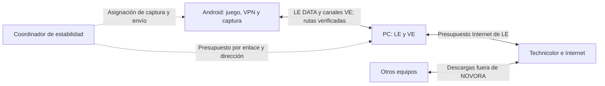

# Plan de estabilidad y capacidad de datos para LE y VE

> **For agentic workers:** REQUIRED SUB-SKILL: Use superpowers:subagent-driven-development (recommended) or superpowers:executing-plans to implement this plan task-by-task. Steps use checkbox (- [ ]) syntax for tracking.

**Goal:** Reducir latencia y jitter bajo carga, y mejorar datos útiles por segundo mediante control de congestión LE, adaptación VE y FILES eficiente.

**Architecture:** Presupuestos independientes para Internet y enlace PC↔Android, con coordinación solo cuando comparten la ruta física. Entregar observación y modo manual antes del adaptativo. Evolucionar FILES mediante negociación, conservando clientes antiguos.

**Tech Stack:** C#/.NET/WPF, .NET Android/MediaCodec/SAF, Rust/Tokio/tcp_ip, TCP/TLS, pruebas de consola y TCP loopback.

**Spec:** [Diseño común](../specs/2026-10-13-le-ve-estabilidad-red-design.md).

Estado: plan propuesto, con prioridad confirmada de latencia estable. No contiene resultados de rendimiento del equipo.

El enlace del dispositivo y la salida Internet se miden por separado. Si LE y VE usan interfaces distintas, el coordinador conserva presupuestos distintos; el tráfico de otros equipos no pasa por sus limitadores.

## Global Constraints

- Aplicar las restricciones del diseño común; conservar CONTROL Version=1 y DATA v1 en la primera entrega.
- Conservar trabajo local preexistente y avisos/licencias; los paquetes nuevos siguen n+1 al preparar la entrega.
- Modo Observe inicialmente; actuar solo sobre rutas y techos válidos y sesiones autorizadas.
- El monitor VE de 20 minutos sigue siendo de solo lectura.
- Mantener seguridad, continuidad de control/audio e integridad de archivos.

## Review Focus

- LE y VE por interfaces distintas: no compartir un presupuesto inexistente.
- Conexión antigua o binario instalado atrasado: capacidad ausente y fallback visible.
- Disco SAF lento y video activo: throttling no debe bloquear cancelación ni producir falso timeout.
- Fallo de codec o grabación activa: adaptación no debe reutilizar un permiso ni corromper el contenedor.
- Congestión de otros equipos del Technicolor: no atribuir estabilidad global a una mejora local.

## Secuencia de implementación

| Bloque | Trabajo | Resultado comprobable | Dependencia |
| --- | --- | --- | --- |
| 0 | Preparar baseline local coherente y reconciliar CI | Se prueba el árbol real que contiene NovoraRelay y VE nativo | Antes de editar producto |
| 1 | LE T1: contratos, métricas y benchmark bajo carga | RTT por origen y señales de cola/caudal | Baseline |
| 2 | LE T2: límites manuales y configuración confirmada del relay | Upload/download limitados y cancelables | 1 |
| 3 | VE T1 y T2: medidas por etapa y presupuesto compartido | FILES cede capacidad sin bloquear control/audio | 1–2 |
| 4 | LE T3 y T4: reparto justo y controlador con histéresis | Menos espera propia y recuperación gradual | 2–3 |
| 5 | VE T3: bitrate vivo y pacing antes de codificar | Se adapta video sin reiniciar captura | 3–4 |
| 6 | VE T4 y T5: FILES binario con ventana y ambos sentidos | Mayor goodput bajo RTT sin sobrecarga hex | 3 |
| 7 | VE T6: FPS/resolución y experimentos medidos | Menos demanda o CPU cuando sea el cuello real | 5–6 |
| 8 | LE T5, VE T7 y validación integrada | Compatibilidad, rollback y evidencia física | Bloques anteriores |

El primer incremento termina en los bloques 1–3: medir y limitar. El segundo añade adaptación y FILES v2. Los cambios de transporte y audio comprimido necesitan experimentos y revisión propios; no bloquean el primer incremento.

## Bloque 0 y protección del trabajo existente

- [ ] Registrar status tracked/untracked filtrado, diff-files y commits; no usar git add . ni limpiar carpetas.
- [ ] Preparar una rama de implementación desde un baseline que incluya las dependencias locales efectivas: NovoraRelay, contratos compartidos, canales VE y suites actuales. No iniciar desde el remoto antiguo asumiendo que contiene estas funciones.
- [ ] Reconciliar .gitignore/.gitattributes/.github y CI en esa rama, conservando SHA de Actions y pruebas remotas; CI Rust debe apuntar a NovoraRelay. No copiar el Cargo.lock de RelayCore al relay nuevo.
- [ ] Ejecutar el verifier actual y documentar fallos antes de cualquier cambio de QoS. Separar los fallos del baseline de nuevas regresiones.
- [ ] Registrar ejecutable relay realmente utilizado y su hash; un binario escuchando el puerto no demuestra que incluya la capacidad nueva.

## Pruebas físicas y aceptación conjunta

### Matriz mínima

USB físico y LAN se prueban por separado, sin presentar ADB inalámbrico como USB. En cada ruta: LE solo, VE solo y LE+VE; añadir FILES PC→Android y Android→PC. Repetir bajada, subida y ambos sentidos; incluir descarga TCP y QUIC, movimiento/video real, almacenamiento SAF lento y desconexión. Incluir el escenario de otros clientes descargando fuera de NOVORA y comparar C20/Technicolor con PC cableada cuando sea posible.

- [ ] Tomar 30 s idle y 60 s con carga por escenario, 3 repeticiones, mismas opciones de codec/audio/juego y endpoint.
- [ ] Comparar goodput, bytes de protocolo, RTT p50/p95/p99, variación RTT, tiempo de controles, edad de cola, FPS mostrados, resets audio, CPU/GC/memoria y SHA-256 de archivos.
- [ ] En el cuello controlado, comprobar objetivo de al menos 30 % menos exceso de RTT p95 sobre idle; con modo desactivado, regresión de goodput inferior o igual al 5 %. No atribuir un fallo de ese criterio bajo carga externa a un defecto probado del shaper sin localizar la cola.
- [ ] Confirmar 20 minutos de sesión mixta estable, sin caída de control/audio/privacidad; medir y explicar cualquier degradación visible antes de preparar paquete.
- [ ] Comprobar candidatos de baja calidad visual, codec que ignora bitrate, peer antiguo y pérdida de métricas, con fallback visible y recuperable.

## Riesgos que determinan el orden

La cola WAN del Technicolor y el enlace inalámbrico del C20 pueden dominar la latencia aunque NOVORA regule su tráfico. El DATA TCP exterior conserva bloqueo entre flujos ante pérdidas. La adaptación basada solo en CPU, drops del renderer o Mbps recibidos puede elegir la acción incorrecta. Los límites manuales y la instrumentación preceden al controlador para distinguir estos casos.

Los archivos v1 tienen dos costes comprobados: expansión hexadecimal y espera por bloque. A 50 ms por respuesta, 24 KiB/bloque equivale idealmente a 3,93 Mbps útiles antes de otros costes. Es una estimación matemática, no un benchmark de la red. V2 elimina esa expansión y admite una ventana pequeña, sin aumentar buffers indiscriminadamente.

## Documentos de ejecución

- [LinkEngine](2026-10-13-le-estabilidad-red.md): contratos, medidas, pacing, fairness, adaptación y configuración/UI.
- [VisionEngine](2026-10-13-ve-capacidad-transferencia.md): colas, budget FILES, bitrate vivo, FILES v2, geometría y perfiles medidos.
- [Diseño común](../specs/2026-10-13-le-ve-estabilidad-red-design.md): interfaces, límites, protocolo y criterios numéricos iniciales.

Durante esta planificación solo se agregan documentos y entradas de Bitacora. No se instalan paquetes, se modifica el router, se ejecutan pruebas de carga o se implementa código de producto.
